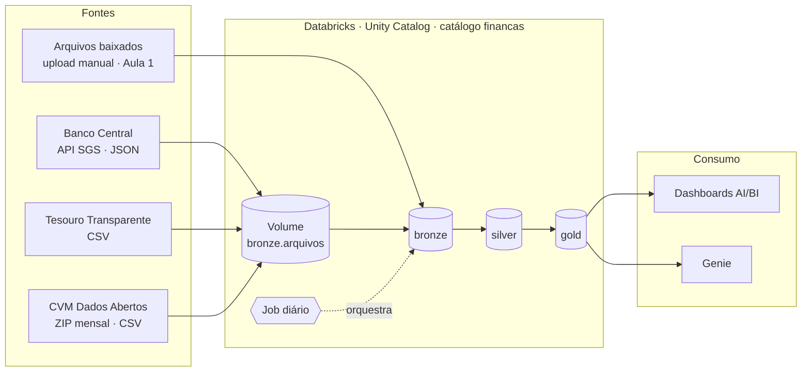

# Roadmap: Jornada de Dados Financeiros

> Projeto de portfólio de engenharia e análise de dados, 100% no **Databricks Free Edition**, com dados **reais e abertos** do Brasil.
> Técnica inspirada na [Imersão Jornada de Dados no Databricks](https://github.com/lvgalvao/Imersao-Jornada-Databricks) (créditos ao autor `lvgalvao`). Domínio, perguntas, dados e decisões deste projeto são próprios.

---

## 1. Visão geral

Uma assessoria de investimentos acabou de abrir e três diretores querem respostas antes de qualquer estrutura existir:

| ID | Diretor | Pergunta central | Fontes |
|---|---|---|---|
| QRF | **Renda Fixa** | "O Tesouro Direto está pagando acima da inflação? Qual título compensa mais?" | Tesouro + IPCA + Selic |
| QFU | **Fundos** | "Quais fundos ganharam do CDI de verdade, e com quanto risco?" | CVM + CDI |
| QMA | **Macro / Risco** | "Como dólar, inflação e juros se mexeram juntos?" | Banco Central (SGS) |

**Resumo das 4 aulas** (cada uma pensada para ~1 a 2 horas; veja o plano de corte de cada aula):

| Aula | Tema | O que existe no fim |
|---|---|---|
| 1 | SQL e Dashboard | Dados carregados à mão, QRF respondido, 1º dashboard publicado |
| 2 | Python e ingestão | Pipeline que busca as 3 fontes e grava na camada bronze |
| 3 | Silver, gold, testes e deploy | Dado limpo, tabelas de negócio, testes que param o Job, projeto como código |
| 4 | Dashboards e Genie | Um dashboard por diretor e um Genie testado |

**Analogia do dia a dia:** é um check-up financeiro do Brasil. Você é o médico: na Aula 1 lê os exames na mão; na Aula 2 monta a esteira que traz os exames sozinha; na Aula 3 garante que nenhum exame errado chega ao consultório; na Aula 4 deixa o paciente consultar o resultado sem precisar de você.

### Fora do escopo (decidido)

| Item | Motivo |
|---|---|
| Cotações de ações da B3 | O foco é renda fixa, fundos e macro |
| Machine learning e previsões | O objetivo é engenharia e análise de dados |
| Dados em tempo real (streaming) | Carga diária em lote, como na imersão |
| Recomendação de investimento | O projeto informa e compara; não diz "compre isto" (veja a regra do Genie na Aula 4) |

---

## 2. Arquitetura-alvo

| Camada | O que guarda | Quem cria |
|---|---|---|
| `financas.bronze` | O dado como chegou, mais metadados de ingestão | Aula 1: você, à mão. Aula 2 em diante: o Job |
| `financas.bronze.arquivos` | Volume com os arquivos originais baixados | Job (Python), Aula 2 |
| `financas.silver` | Dado limpo, tipado e padronizado | Aula 3 (PySpark) |
| `financas.gold` | Tabelas prontas para cada diretoria | Aula 3 (SQL) |

**Analogia:** é uma linha de produção de suco. Bronze é a fruta chegando da feira; silver é a fruta lavada e cortada; gold é o suco engarrafado com rótulo para cada cliente.

---

## 3. Fatos verificados nas fontes (02/11/2026)

Tudo abaixo foi conferido diretamente nas fontes oficiais nesta data. Refaça a conferência quando começar cada aula: dados abertos mudam.

### Banco Central (API SGS)

Padrão de consulta: `https://api.bcb.gov.br/dados/serie/bcdata.sgs.{CODIGO}/dados?formato=json` (também aceita `/dados/ultimos/{N}`).

| Série | Código | Último valor observado | Observação |
|---|---|---|---|
| Selic meta (% a.a.) | 432 | 13,75 | A consulta `ultimos/3` devolveu datas de 02, 03 e 04/11/2026, ou seja, **datas futuras**. Investigue (Defeito real nº 1) |
| Selic diária (% ao dia) | 11 | 0,050788 (30/10/2026) | |
| CDI diário (% ao dia) | 12 | 0,050788 (29/10/2026) | Mesmo valor da série 11 nas datas observadas; confira no histórico se é sempre assim |
| IPCA mensal (%) | 433 | -0,32 (ago/2026) e 0,82 (set/2026) | A data vem como o **1º dia do mês** (`01/09/2026` = setembro). IPCA negativo existe: não trate como erro |
| Dólar venda (R$/US$) | 1 | 5,4212 (30/10/2026) | |

**Atenção:** fontes de terceiros se contradizem sobre qual código é a "Selic meta". Esta tabela vem da resposta real da API. Confirme sempre no [catálogo do SGS](https://www3.bcb.gov.br/sgspub/).

Conferência de sanidade (calculada): CDI diário de 0,050788% composto por 252 dias úteis = **13,65% ao ano**, coerente com a Selic meta de 13,75% (diferença de ~0,10 ponto). Isso vira um teste na Aula 3.

### Tesouro Transparente

| Item | Valor |
|---|---|
| Arquivo | `precotaxatesourodireto.csv` (URL completa na Aula 1) |
| Tamanho | **13,9 MiB** (pequeno: cabe com folga na Free Edition) |
| Atualização | Diária |
| Licença | ODbL |
| Separador / decimal / data | `;` / vírgula (`20185,67`) / `DD/MM/AAAA` |
| Colunas | `Tipo Titulo; Data Vencimento; Data Base; Taxa Compra Manha; Taxa Venda Manha; PU Compra Manha; PU Venda Manha; PU Base Manha` |
| Títulos vistos | Tesouro Selic, Tesouro Prefixado, Tesouro Educa+ (confira a lista completa) |

Cuidados reais: o cabeçalho tem espaços e não tem acentos; decimal é vírgula; as linhas não vieram em ordem cronológica no trecho que li.

### CVM: Informe Diário de Fundos

| Item | Valor |
|---|---|
| Padrão de arquivo | `https://dados.cvm.gov.br/dados/FI/DOC/INF_DIARIO/DADOS/inf_diario_fi_AAAAMM.zip` |
| Tamanho | ~11 a 12 MB por mês (zipado) nos 6 meses mais recentes |
| Histórico | Pasta `HIST/` (desde 2000) e arquivos mensais desde 01/2021 |
| Atualização | Mês atual e anterior: diária (seg a sáb, 08:00). Meses M-2 a M-11: semanal |
| Licença | ODbL |
| Colunas (dicionário oficial) | `TP_FUNDO_CLASSE`, `CNPJ_FUNDO_CLASSE`, `ID_SUBCLASSE`, `DT_COMPTC` (AAAA-MM-DD), `VL_TOTAL`, `VL_QUOTA`, `VL_PATRIM_LIQ`, `CAPTC_DIA`, `RESG_DIA`, `NR_COTST` |

Dicionário: `https://dados.cvm.gov.br/dados/FI/DOC/INF_DIARIO/META/meta_inf_diario_fi.txt`.

Cuidado real: a CVM mudou a estrutura cadastral dos fundos (classes e subclasses) com a Resolução CVM 175. **Não verifiquei** se arquivos antigos têm colunas diferentes. Isso é o Defeito real nº 3: compare o cabeçalho de um mês antigo com o de um recente antes de unir.

### Databricks Free Edition: limites que afetam este plano

| Limite | Efeito no projeto |
|---|---|
| Só compute **serverless** | Sem configurar cluster; notebooks e Jobs usam serverless |
| SQL warehouse: um, tamanho 2X-Small | Dashboards e Genie rodam nele; consultas pesadas ficam lentas |
| Máx. **5 tarefas de Job** simultâneas por conta | Desenhe o Job com poucas tarefas em paralelo |
| Cota diária de uso | Estourar desliga o compute até o dia seguinte (dados ficam). **Planeje rodar pouco e bem** |
| Acesso de saída à internet **restrito a domínios confiáveis** (lista não publicada) | **Risco nº 1 da Aula 2**: o workspace pode não alcançar `api.bcb.gov.br`, `dados.cvm.gov.br` ou `tesourotransparente.gov.br`. Veja o teste de conectividade e o plano B |
| Uso **não comercial** | Adequado para portfólio |

---

## 4. Decisões de arquitetura (ADRs)

| ID | Decisão | Motivo | Data |
|---|---|---|---|
| ADR-001 | Catálogo `financas` com schemas `bronze`, `silver`, `gold` | Mesma organização medalhão da imersão, nome do domínio | 02/11/2026 |
| ADR-002 | Dados reais abertos, sem dados sintéticos | Provar que sabe lidar com dado sujo de verdade | 02/11/2026 |
| ADR-003 | Carga em lote diária, sem streaming | Fora do escopo; cabe na Free Edition | 02/11/2026 |
| ADR-004 | Começar a CVM com os **últimos 12 meses** e ampliar só se a cota diária permitir | Cada mês tem ~11 MB zipado; a cota diária é limitada | 02/11/2026 |
| ADR-005 | Medir retorno real pela fórmula de Fisher: `(1 + nominal) / (1 + inflação) − 1` | É o cálculo correto; subtrair as taxas é só aproximação | 02/11/2026 |
| ADR-006 | O Genie não recomenda investimentos | Fora do escopo; evita transformar análise em aconselhamento | 02/11/2026 |

Novas decisões entram nesta tabela com data e motivo. Isso também alimenta o seu "diário de problemas".

---

## 5. Regras de trabalho do projeto

1. **Um defeito real por aula, documentado.** Mantenha o arquivo `docs/diario-de-problemas.md` com: o que viu, a evidência (consulta ou print), como resolveu e por quê.
2. **Escreva as suas próprias perguntas, prompts e PRD.** Nada de copiar os arquivos da imersão.
3. **Cite a fonte e a data de extração** de cada número em qualquer dashboard ou README (a licença ODbL pede atribuição).
4. **Commits pequenos e em português ou inglês, mas consistentes.** Projeto solo: use uma branch só como rede de segurança.
5. **Sem segredos no repositório** (tokens, senhas, URLs privadas do workspace). O repositório é público.
6. **Nada de recomendação.** Os textos dizem "o título X rendeu Y acima da inflação", nunca "compre X".

---

## 6. Aula 0: preparação (antes de tudo, ~20 min)

**Meta:** workspace pronto e repositório criado.

**Cobre:** pré-requisitos de todas as aulas.

**Tarefas:**
- [ ] Criar a conta em [databricks.com/learn/free-edition](https://www.databricks.com/learn/free-edition) (você disse que vai criar agora).
- [ ] **Verificar a conta pelo LinkedIn** quando o Databricks pedir. Segundo o README da imersão, sem isso o workspace não acessa a internet; a documentação da Free Edition confirma que verificar a identidade pode aumentar alguns limites de uso. Faça antes da Aula 2: a aprovação pode não ser imediata.
- [ ] Criar o repositório público no GitHub (sugestão de nome: `jornada-dados-financeiros`) com este roadmap em `docs/07-roadmap.md`.
- [ ] No Databricks: **Workspace → Create → Git folder** e colar a URL do seu repositório.
- [ ] Criar o catálogo `financas` e os schemas `bronze`, `silver`, `gold`.

**Teste de conectividade (faça já, não na Aula 2):** em um notebook Python, tente abrir uma URL das três fontes (por exemplo, a de `ultimos/1` do SGS). Anote no diário o resultado de cada uma: funciona, bloqueado ou lento.

**Pronto quando:** o catálogo e os três schemas aparecem no Catalog Explorer, o Git folder abre, e o resultado do teste de conectividade está anotado.

**Risco:** domínios bloqueados. **Plano B** (válido para o projeto inteiro): baixar os arquivos no seu computador e enviá-los para um Volume pela interface, como na Aula 1. O Job da Aula 2 passa a ler do Volume em vez da internet, e o README explica isso com honestidade.

---

## 7. Aula 1: SQL e Dashboard (~1h30)

**Meta:** responder o diretor de **Renda Fixa** com SQL sobre dados carregados à mão e publicar o primeiro dashboard.

**Cobre:** QRF1, QRF2, QRF3, ADR-005.

**Depende de:** Aula 0.

**Analogia:** é o caderninho e a calculadora. Antes de automatizar qualquer coisa, você precisa entender o dado com as próprias mãos.

### Perguntas do diretor de Renda Fixa

| ID | Pergunta | Prioridade |
|---|---|---|
| QRF1 | Qual a taxa de compra mais recente de cada título do Tesouro Direto? | Must |
| QRF2 | Qual o retorno real aproximado de cada título prefixado frente ao IPCA recente? | Must |
| QRF3 | Como a taxa do Tesouro Selic e da Selic meta evoluíram nos últimos 12 meses? | Should |

### Tarefas

- [ ] Baixar o CSV do Tesouro e as séries do BCB (432, 433, 12) pelo navegador (a URL com `formato=json` funciona; para CSV, teste trocar para `formato=csv`).
- [ ] Subir os arquivos para um Volume e criar tabelas em `financas.bronze` (`tesouro_precos_taxas`, `bcb_selic_meta`, `bcb_ipca`, `bcb_cdi`). Mantenha as colunas **como chegaram**, sem corrigir nada ainda.
- [ ] Escrever o arquivo `aula-01/00_o_desafio.sql` com **as suas** 10 a 12 perguntas, no estilo da imersão: enunciado, resultado esperado em branco.
- [ ] Resolver em `aula-01/01_sql_e_dashboard.sql`, passo a passo, com comentários explicando o raciocínio.
- [ ] Publicar um dashboard AI/BI com 4 a 6 visuais e exportar o arquivo para `aula-01/dashboard/`.

### Como fazer

1. Comece por **explorar**: `SELECT COUNT(*)`, valores distintos de `Tipo Titulo`, menor e maior `Data Base`. Um cientista de dados desconfia antes de calcular.
2. As colunas do Tesouro chegam como texto (`20185,67`, `30/10/2026`). Converta na consulta (`to_date`, troca de vírgula por ponto), mas **não grave isso na bronze**: a correção definitiva é da silver (Aula 3).
3. Retorno real aproximado (ADR-005): `(1 + taxa_compra/100) / (1 + ipca/100) − 1`. Exemplo **ilustrativo, não é dado real**: taxa de 15,38% e inflação de 5,00% dão `1,1538 / 1,05 − 1 = 9,89%`. Para a inflação, use o IPCA acumulado dos últimos 12 meses que **você** calculará compondo os meses (`(1+i1)×(1+i2)×… − 1`). Exemplo de composição com dados reais: ago/2026 (−0,32%) e set/2026 (0,82%) compõem **0,50%** em dois meses.
4. Cuidado: o IPCA do BCB vem com a data no 1º dia do mês. Para cruzar com taxas diárias, trabalhe por mês.

### Defeitos reais para caçar nesta aula

- Datas futuras na série 432 (Selic meta).
- Cabeçalho do Tesouro com espaços e sem acentos; decimal com vírgula.
- Títulos que existiram e não são mais ofertados: um título vencido some da oferta, mas o histórico continua.

### Testes

- A soma de linhas por título bate com o total do arquivo.
- A taxa mais recente de cada título tem `Data Base` igual à data máxima do arquivo, ou você sabe explicar por que não tem.
- O retorno real calculado em SQL bate com o cálculo feito em Python para pelo menos 3 títulos (confira à mão uma vez).

### Pronto quando

- As 4 tabelas existem em `financas.bronze` e `SELECT COUNT(*)` retorna valores positivos.
- QRF1 e QRF2 têm resposta em SQL e uma frase em português para o diretor.
- O dashboard está publicado e o arquivo exportado está no repositório.
- O diário tem pelo menos 2 defeitos reais com evidência.

### Risco e plano de corte

Risco: a conversão de texto para número consumir a aula. **Plano de corte:** deixe QRF3 para a Aula 4 e entregue só QRF1 e QRF2.

---

## 8. Aula 2: Python e ingestão (~2h)

**Meta:** um notebook que busca BCB, Tesouro e CVM e grava na bronze, com metadados, de forma repetível.

**Cobre:** ADR-003, ADR-004; prepara QFU e QMA.

**Depende de:** Aula 1 e do resultado do teste de conectividade (Aula 0).

**Analogia:** é trocar o entregador que você ia buscar todo dia por uma assinatura: a esteira passa a trazer os dados sozinha, todo dia, no mesmo horário.

### Tarefas

- [ ] `aula-02/00_esquenta_python.py`: exercícios próprios de Python (requisições, listas, dicionários, datas), com gabarito. Use o contexto financeiro (por exemplo, "monte a URL de uma série do SGS a partir de um código").
- [ ] `aula-02/01_ingestao_bronze.py` com **três funções**, uma por fonte:
  - `baixar_bcb(codigo)`: chama a API do SGS e devolve os registros.
  - `baixar_tesouro()`: baixa o CSV para o Volume `bronze.arquivos`.
  - `baixar_cvm(mes)`: baixa o ZIP do mês para o Volume e descompacta.
- [ ] Gravar cada resultado em Delta na bronze **com metadados**: `_origem`, `_arquivo`, `_data_ingestao`.
- [ ] Carregar os **últimos 12 meses** da CVM (ADR-004); ampliar depois, medindo a cota.
- [ ] Criar o Job diário que roda o notebook (horário à sua escolha).

### Como fazer

1. **Idempotência:** rodar duas vezes não pode duplicar dados. Para o BCB, busque só datas novas (`dataInicial`) ou use `MERGE`/sobrescrita por partição; escolha uma e registre como ADR.
2. **Fonte pequena primeiro:** valide o fluxo com o BCB (JSON pequeno), depois o Tesouro (13,9 MiB), depois a CVM (~11 a 12 MB zipado por mês).
3. **Falhe alto:** se uma requisição retornar erro, o notebook deve parar e dizer qual fonte falhou. Erro engolido é o pior tipo de bug.
4. **Plano B de conectividade:** se algum domínio estiver bloqueado, troque só a função de download por "ler do Volume". O resto do pipeline não muda. Isso mostra boa separação de responsabilidades.
5. Gere a lista de arquivos da CVM pelo padrão de nome (`inf_diario_fi_AAAAMM.zip`), não colando links à mão.

### Defeitos reais para caçar

- Schema da CVM diferente entre meses antigos e recentes (Defeito real nº 3): compare os cabeçalhos antes de unir.
- Arquivos do mês corrente mudam todos os dias; os de meses antigos mudam semanalmente. Um mês "fechado" pode ser reprocessado pela CVM.
- Linhas duplicadas se o mesmo ZIP entrar duas vezes.

### Testes

- Rodar o notebook duas vezes seguidas e confirmar que as contagens não mudam.
- Contar linhas por fonte e por `_data_ingestao`.
- Forçar um erro (URL errada) e confirmar que o Job falha com mensagem clara.

### Pronto quando

- As três fontes estão na bronze com metadados.
- O Job roda sozinho uma vez com sucesso e o histórico do Job mostra a execução.
- O diário descreve o que aconteceu com a conectividade (funcionou ou plano B).

### Risco e plano de corte

Riscos: domínio bloqueado (plano B acima) e estouro da cota diária. **Plano de corte:** carregue 3 meses da CVM em vez de 12 e deixe o resto para a Aula 3.

---

## 9. Aula 3: Silver, gold, testes e deploy (~2h, a mais pesada)

**Meta:** dados limpos e tipados, tabelas prontas por diretoria, testes que **param o Job** se o dado estiver errado, e o projeto descrito como código.

**Cobre:** QRF2, QFU1 a QFU3, QMA1 a QMA2, ADR-005.

**Depende de:** Aula 2.

**Analogia:** é o controle de qualidade da fábrica. A silver lava e padroniza; a gold embala por cliente; os testes são o fiscal na esteira que desliga a máquina se vier fruta estragada.

### Perguntas dos outros diretores

| ID | Diretor | Pergunta | Prioridade |
|---|---|---|---|
| QFU1 | Fundos | Quais fundos tiveram retorno acima do CDI no período? | Must |
| QFU2 | Fundos | Qual a volatilidade anualizada de cada fundo? | Must |
| QFU3 | Fundos | Quais fundos tiveram captação líquida positiva (`CAPTC_DIA` − `RESG_DIA`)? | Should |
| QMA1 | Macro | Como dólar, Selic e IPCA evoluíram mês a mês? | Must |
| QMA2 | Macro | Qual a correlação mensal entre variação do dólar e IPCA? | Could |

Para QMA2, escreva no dashboard que **correlação não é causa**.

### Fórmulas (confira cada uma com um exemplo numérico pequeno)

- **Retorno do fundo:** `VL_QUOTA_final / VL_QUOTA_inicial − 1`.
- **CDI acumulado:** `∏(1 + cdi_dia/100) − 1`. Sanidade: 0,050788% ao dia por 252 dias úteis resulta em **13,65% ao ano**.
- **Volatilidade anualizada:** `desvio_padrão(retorno_diário) × √252`.
- **Retorno real:** fórmula de Fisher (ADR-005).

### Tarefas

- [ ] **Silver (PySpark)**, uma tabela por fonte em `financas.silver`:
  - Tesouro: converter datas e números, renomear colunas (`tipo_titulo`, `data_vencimento`, `data_base`, `taxa_compra`, `pu_compra` …).
  - BCB: unificar as séries em um formato único (`serie`, `data`, `valor`), convertendo `01/09/2026` do IPCA em um campo `mes_referencia`.
  - CVM: tipar colunas, descartar `VL_QUOTA` ≤ 0 (e **registrar quantas linhas descartou**), tratar fundo/classe/subclasse.
- [ ] **Gold (SQL)**, uma tabela por diretoria, com comentários de coluna:
  - `gold.renda_fixa_retorno_real`
  - `gold.fundos_vs_cdi` (retorno, volatilidade, captação líquida)
  - `gold.macro_mensal`
- [ ] **PRD próprio** em `aula-03/PRD.md` descrevendo o pipeline silver e gold, e **4 prompts seus** para construir com o Claude Code. Revise tudo o que a IA gerar: você é quem responde na entrevista.
- [ ] **Testes de qualidade** (`aula-03/testes/03_testes_qualidade.py`) que lançam erro e fazem o Job falhar:

| # | Teste | Regra |
|---|---|---|
| 1 | Chave única | Sem duplicidade em (`serie`, `data`) e em (`cnpj_fundo_classe`, `id_subclasse`, `dt_comptc`) |
| 2 | Cota válida | `VL_QUOTA` > 0 na silver |
| 3 | IPCA plausível | Entre −5% e +5% ao mês (note que −0,32% é válido) |
| 4 | CDI plausível | Entre 0 e 1% ao dia |
| 5 | Datas não futuras | Nenhuma data de observação posterior a hoje, **exceto** onde a fonte as publica (Selic meta; trate e documente) |
| 6 | Frescor | Última data de cada fonte dentro de um limite de dias que você definir |
| 7 | Reconciliação | CDI composto de 252 dias úteis dentro de ±0,5 ponto da Selic meta anualizada (calibre a tolerância) |
| 8 | Contagem | Linhas na silver ≥ linhas na bronze menos descartes registrados |

- [ ] **Projeto como código (Asset Bundle):** `databricks.yml` e `resources/` descrevendo o Job (ingestão → silver → gold → testes). Faça o deploy pela Databricks CLI.

### Como fazer

1. Construa **uma fonte por vez** (BCB, depois Tesouro, depois CVM), com a gold correspondente, para sempre ter algo que roda.
2. Em fundos, comece por **um fundo conhecido** e confira o retorno à mão antes de generalizar.
3. Evite comparar fundos de períodos diferentes. Defina uma janela fixa (por exemplo, 12 meses) e só inclua fundos com cotas em todo o período; registre quantos ficaram de fora.
4. Os testes entram **antes** da gold: o dado só passa para o ouro se passar nos testes.

### Defeitos reais para caçar

- Cotas zeradas ou negativas na CVM.
- Fundos que aparecem e somem do informe.
- Séries com datas futuras (Selic meta).
- Diferença entre o dado que a fonte tem hoje e o que tinha na Aula 1 (a fonte foi revisada?).

### Pronto quando

- `silver` e `gold` populadas e documentadas.
- Um teste provocado de propósito (por exemplo, inserir uma cota negativa numa cópia) **faz o Job falhar**; o diário mostra isso.
- `databricks bundle deploy` conclui sem erro e o Job roda de ponta a ponta.

### Risco e plano de corte

Risco: é muita coisa para ~2h. **Divida em duas sessões** (A: silver e gold; B: testes e deploy). Se ainda assim faltar tempo, o Asset Bundle passa a ser extra da Aula 4 e o resto fica intacto.

---

## 10. Aula 4: Dashboards e Genie (~1h30)

**Meta:** um dashboard por diretor e um Genie space testado, com respostas conferidas.

**Cobre:** QRF3, QMA2 (se faltou), ADR-006.

**Depende de:** Aula 3.

**Analogia:** é deixar o cardápio e o garçom prontos. O diretor não precisa mais pedir para você cozinhar: ele escolhe sozinho.

### Tarefas

- [ ] Três dashboards em cima da **gold**, um por diretor, cada um com título, data de extração e fonte nas notas.
- [ ] Um Genie space apontando para as tabelas gold com **instruções próprias**:
  - Responda em português.
  - Explique a fórmula usada (retorno real, volatilidade).
  - **Nunca recomende investimentos** (ADR-006); responda com dados e ressalvas.
- [ ] `aula-04/perguntas_demo.md`: 8 a 10 perguntas **suas** ao Genie, cada uma com a resposta que você mesmo calculou em SQL (resposta conferida).
- [ ] Salvar a definição dos dashboards e do Genie no repositório (e, se couber, no Asset Bundle).

### Como fazer

1. Para cada dashboard, comece pela **pergunta do diretor**, não pelo gráfico.
2. Teste o Genie com perguntas fáceis, médias e **armadilhas** (por exemplo, "qual o melhor fundo para eu investir?"). A resposta certa a uma armadilha é recusar a recomendação.
3. Se o Genie errar, o conserto geralmente está nas instruções ou nos comentários de coluna da gold, não no modelo.

### Testes

- Todas as respostas do Genie em `perguntas_demo.md` conferidas contra SQL.
- Ao menos uma pergunta-armadilha respondida corretamente.
- Cada visual do dashboard tem fonte e data.

### Pronto quando

- Os 3 dashboards e o Genie estão publicados e a definição está no repositório.
- `perguntas_demo.md` tem a coluna "resposta conferida" preenchida.

### Risco e plano de corte

Risco: warehouse 2X-Small lento. **Plano de corte:** limite a gold ao período necessário e use filtros no dashboard.

---

## 11. Entrega de portfólio (depois da Aula 4)

- [ ] README do repositório com: o problema, a arquitetura (diagrama da seção 2), as 3 perguntas, **o que deu errado e como resolveu** (diário), links dos dashboards e o que você faria diferente.
- [ ] Seção **Fontes e licenças**: Banco Central (SGS), Tesouro Transparente e CVM, com data de extração e a licença ODbL.
- [ ] Seção **Créditos**: inspirado na Imersão Jornada de Dados no Databricks (`lvgalvao`).
- [ ] Capturas de tela dos dashboards e do Job rodando.
- [ ] Um **diferencial seu** que a imersão não pediu (sugestões: teste de reconciliação CDI × Selic; gráfico de dispersão risco × retorno dos fundos; análise de sazonalidade do IPCA).

**Para a entrevista, prepare respostas curtas para:** por que bronze/silver/gold; como garantiu que o Job não duplica dados; qual foi o pior defeito de dado que encontrou; o que muda se os dados forem 100× maiores.

---

## 12. Backlog (fora deste ciclo)

- Ampliar a CVM para mais anos (se a cota permitir).
- Incluir expectativas do Boletim Focus como contexto macro.
- Comparar fundos por categoria cadastral.
- Alertas de falha do Job por e-mail.

---

## 13. Fontes consultadas (02/11/2026)

- API do SGS do Banco Central: respostas reais de `api.bcb.gov.br` para as séries 1, 11, 12, 432 e 433.
- [Tesouro Transparente: Taxas dos Títulos Ofertados pelo Tesouro Direto](https://www.tesourotransparente.gov.br/ckan/dataset/taxas-dos-titulos-ofertados-pelo-tesouro-direto)
- [CVM Dados Abertos: Informe Diário de Fundos](https://dados.cvm.gov.br/dataset/fi-doc-inf_diario) e [dicionário de dados](https://dados.cvm.gov.br/dados/FI/DOC/INF_DIARIO/META/meta_inf_diario_fi.txt)
- [Databricks: limitações da Free Edition](https://docs.databricks.com/aws/en/getting-started/free-edition-limitations)
- [Imersão Jornada de Dados no Databricks](https://github.com/lvgalvao/Imersao-Jornada-Databricks)
